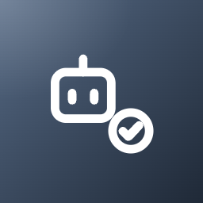
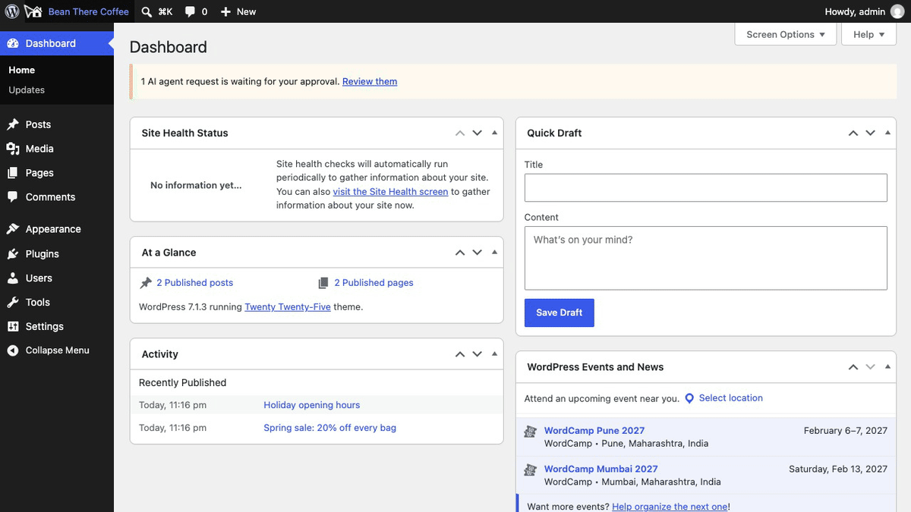
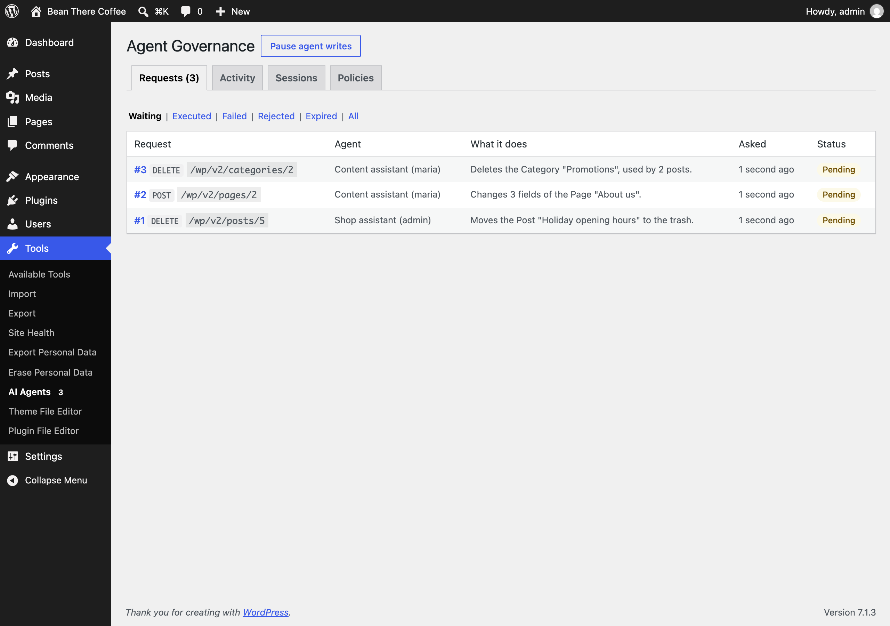
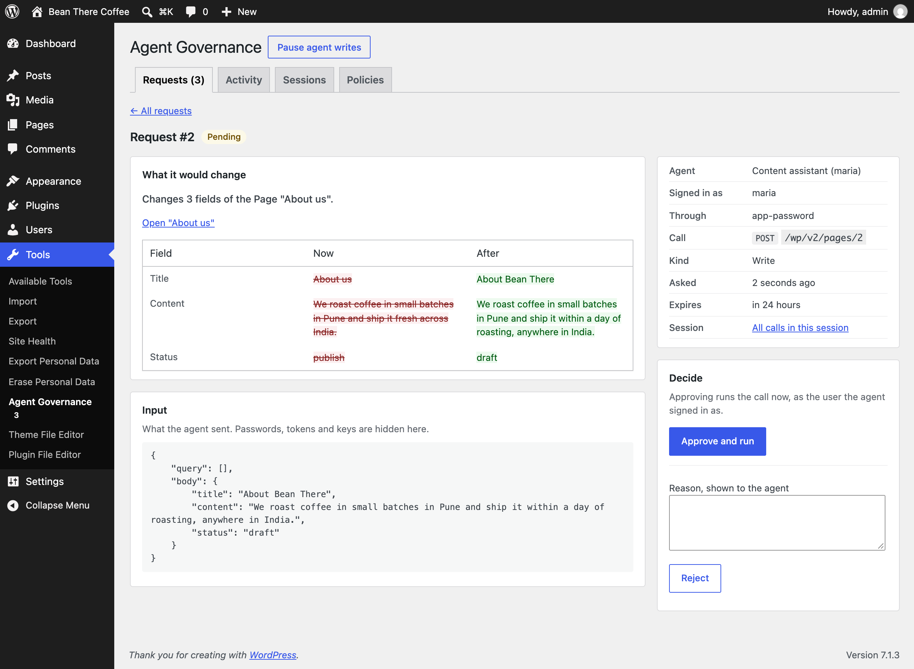
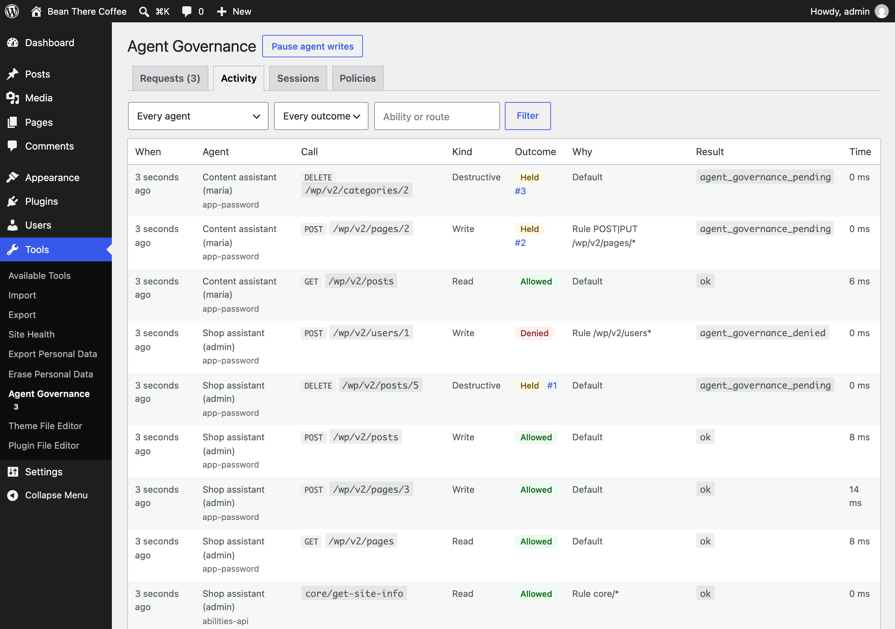
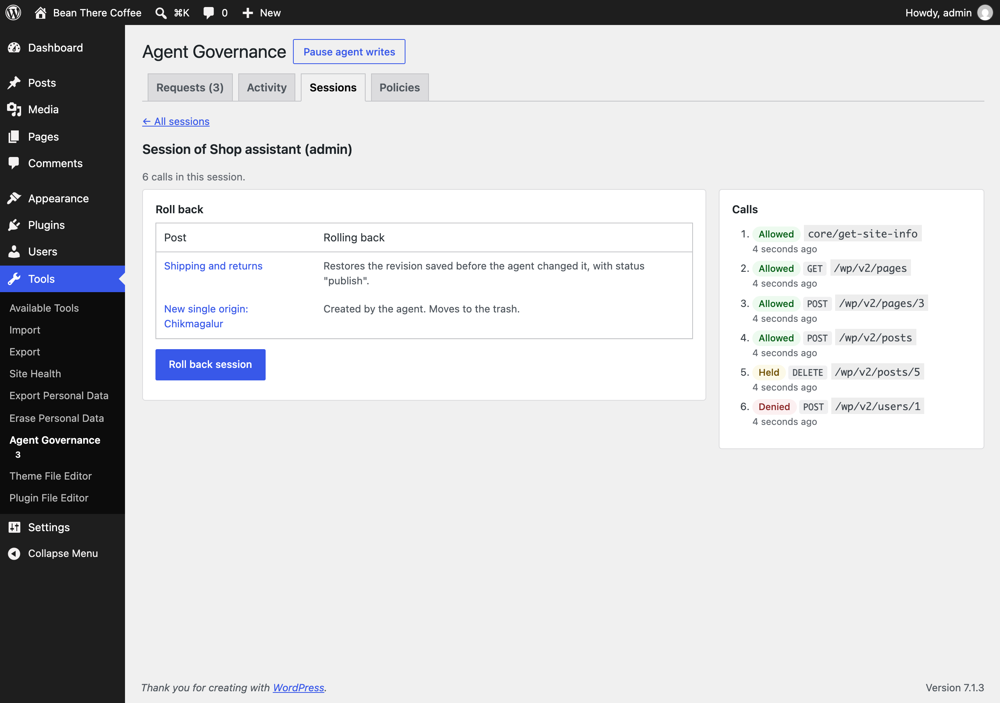
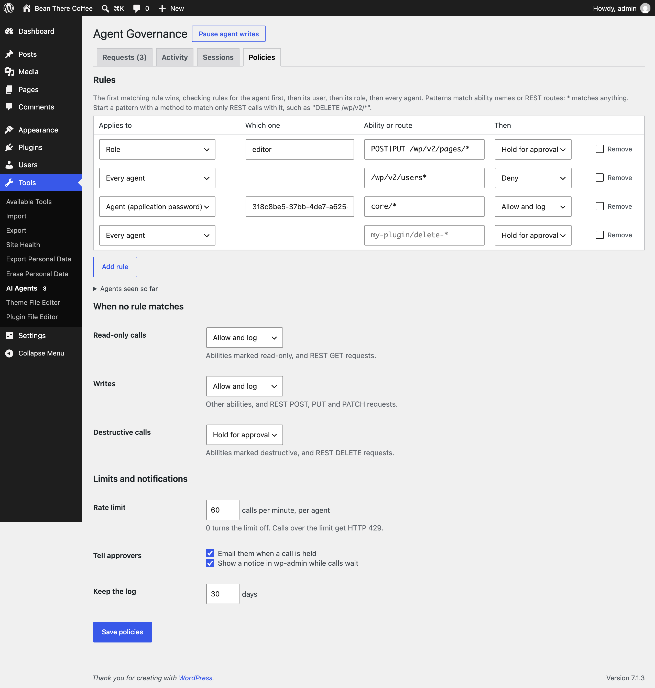

<p align="center"></p>

<h1 align="center">Agent Governance</h1>

<p align="center">
  <a href="https://playground.wordpress.net/?blueprint-url=https://raw.githubusercontent.com/aryanjasala/agent-governance/main/blueprint.json"></a>
  <a href="https://github.com/aryanjasala/agent-governance/releases/latest"></a>
  
  
  <a href="LICENSE.md"></a>
  <br>
  <a href="https://github.com/aryanjasala/agent-governance/actions/workflows/phpcs.yml"></a>
  <a href="https://github.com/aryanjasala/agent-governance/actions/workflows/phpstan.yml"></a>
  <a href="https://github.com/aryanjasala/agent-governance/actions/workflows/unit-tests.yml"></a>
  <a href="https://github.com/aryanjasala/agent-governance/actions/workflows/e2e-tests.yml"></a>
  <a href="https://github.com/aryanjasala/agent-governance/actions/workflows/plugin-check.yml"></a>
</p>

<p align="center">Hold risky AI agent actions until a person approves them, see exactly what they would change, and roll back an agent's session.</p>

<p align="center">
  
</p>

---

AI agents now work on WordPress through the Abilities API, the MCP adapter and application passwords. You can already limit which abilities an agent may call. What is missing is a person in the loop. Agent Governance holds risky agent calls until someone approves them, shows exactly what each one would change, logs every call, and rolls back what an agent did in a session.

> [!NOTE]
> Free and open source under the GPL. No pro version, no upsells, no ads in wp-admin, no tracking. And it stays that way.

## Features

- **Knows which calls are agents**: the MCP adapter (HTTP and `wp mcp-adapter serve`) and REST requests signed in with an application password, the Abilities REST API included. Each application password is its own agent. A person in wp-admin is never held, even when a screen runs abilities
- **Approval queue**: risky calls get HTTP 202 and a request ID, and wait. The agent polls `agent-governance/get-request` for the outcome and the result. Approvers find them under **Tools > AI Agents**
- **Dry-run preview**: each field before and after, for posts, pages, terms, users, settings and plugins. Abilities add their own through a filter, and the rest show what the ability says it does
- **Approve and run** as the user the agent signed in as, or **reject** with a reason the agent sees. Unanswered requests expire after a day. An agent can never approve its own request
- **Policies** per agent, user, role or for every agent, with `*` patterns on abilities and REST routes: allow, deny or hold for approval
- **Rate limit** per agent with a `Retry-After` header, and a **Pause** button that refuses every agent write while reads keep working
- **Audit log** of every call with the input (secrets removed), outcome and timing, grouped into **sessions**. Calls another plugin refused, such as Site Read-Only Mode during a freeze, are in it too
- **Roll back a session**: edited posts go back to the revision saved before the agent touched them, created posts go to the trash, after a preview
- **Never without an approver**: if a role clean-up takes the approver capability off every role, administrators still approve, and a notice gives it back in one click
- **Privacy** export and erase, **WP-CLI** for everything, abilities, and a **Site Health** check

## Install

1. Download `agent-governance.zip` from the [latest release](https://github.com/aryanjasala/agent-governance/releases/latest).
2. In WordPress, go to **Plugins > Add New Plugin > Upload Plugin**, choose the zip and activate it.

Or with WP-CLI:

```sh
wp plugin install https://github.com/aryanjasala/agent-governance/releases/latest/download/agent-governance.zip --activate
```

Needs WordPress 6.9+ and PHP 7.4+. To try it first, the **Try in WordPress Playground** badge opens a throwaway WordPress in your browser with the plugin and some demo content.

## Quick look

An agent deletes a post with its application password. The call is held, and the agent gets a request ID:

```sh
curl -u maria:"abcd efgh ijkl mnop qrst uvwx" -X DELETE https://example.com/wp-json/wp/v2/posts/42
# HTTP 202 {"code":"agent_governance_pending","data":{"status":202,"request_id":12, ...}}
```

Approve it from **Tools > AI Agents**, or from the command line:

```sh
wp agent-governance pending
wp agent-governance approve 12
wp agent-governance add-rule "DELETE /wp/v2/users*" deny
wp agent-governance rollback 6f0c2f8e-0a3e-4f53-9d1c-0d6a1f1c4b8a --dry-run
```

## Screenshots

<table>
  <tr>
    <td width="50%" valign="top"><br><sub>The approval queue: agent calls waiting for a person, with what each would do</sub></td>
    <td width="50%" valign="top"><br><sub>A held request with its dry-run preview, before approving or rejecting it</sub></td>
  </tr>
  <tr>
    <td width="50%" valign="top"><br><sub>Activity: every agent call and its outcome, with filters</sub></td>
    <td width="50%" valign="top"><br><sub>Reviewing an agent session before rolling it back</sub></td>
  </tr>
  <tr>
    <td width="50%" valign="top"><br><sub>Policies: rules per agent, user or role, the defaults, the rate limit and notifications</sub></td>
  </tr>
</table>

## Documentation

| Doc | What it covers |
| --- | --- |
| [Reference](docs/REFERENCE.md) | How calls are classified and decided, held requests, previews, rollback, hooks, abilities, WP-CLI, data and privacy |
| [Development](docs/DEVELOPMENT.md) | Local setup, commands and tests |
| [Contributing](docs/CONTRIBUTING.md) | Pull requests, required checks and PR titles |
| [Releasing](docs/RELEASING.md) | How merged pull requests become releases |
| [Security](docs/SECURITY.md) | Reporting a vulnerability |
| [readme.txt](readme.txt) | What WordPress.org shows, with the FAQ and changelog |

## Project structure

```
agent-governance.php      plugin header and PSR-4 autoloader
src/
├── Plugin.php            creates the services
├── Requirements.php      the WordPress 6.9 check
├── Schema.php            tables, capability, schedule
├── Capability.php        the approver capability and its fallback
├── Settings.php          settings and rules
├── Context.php           what this request knows: app password, route, MCP
├── Classifier.php        agent or not, and which agent
├── Policy.php            the policy engine
├── Gate.php              applies decisions: log, refuse, hold
├── Guards/               the ability and REST checks
├── DryRun.php            before and after previews
├── Requests.php          the approval queue table
├── Approvals.php         approve, reject, run, expire
├── Log.php               the audit log table and sessions
├── Changes.php           post changes per agent call
├── Rollback.php          session rollback
├── Redactor.php          secrets out, size caps
├── Notifier.php          email and notice to approvers
├── Cleanup.php           the hourly clean-up
├── Privacy.php           export, erase and policy text
├── Abilities.php         abilities for agents and approvers
├── Admin/                Tools > AI Agents
├── Health/SiteHealth.php the Site Health check
└── Cli/Command.php       wp agent-governance
assets/                   admin.css, admin.js
tests/
├── Unit/                 PHPUnit
└── e2e/                  Playwright specs, fixture and the Docker site
.wordpress-org/           screenshots
docs/                     reference, development, contributing, releasing
```

## More free plugins

Small plugins that each fill one gap in WordPress, all free with no pro version:

| | Plugin | What it does |
| --- | --- | --- |
|  | [Page Template Usage](https://github.com/aryanjasala/page-template-usage) | See which template every page uses, and fix the pages on a missing template |
|  | [Staging Guard](https://github.com/aryanjasala/staging-guard) | Stops staging copies from emailing real people or getting indexed |
|  | [Category & Tag Trash](https://github.com/aryanjasala/category-tag-trash) | A trash for categories, tags and custom terms, with undo and full restore |
|  | [Axle Read-Only Mode](https://github.com/aryanjasala/axle-read-only-mode) | Read-only mode for WordPress during migrations and deploys |
|  | [Restore Blocks from Revisions](https://github.com/aryanjasala/restore-blocks-from-revisions) | Restore a single block from an old revision, not the whole post |
|  | [Activity Log with Undo](https://github.com/aryanjasala/activity-log-with-undo) | An activity log where every change you can reverse has an Undo button |
|  | [Block Doctor](https://github.com/aryanjasala/block-doctor) | Scan the whole site for invalid and broken blocks and fix them in bulk, with undo |
|  | [Block Theme Ops](https://github.com/aryanjasala/block-theme-ops) | Find Site Editor changes that override your theme files, see the diff, reset them or send them to Git |
|  | [Role Right-Sizer](https://github.com/aryanjasala/role-right-sizer) | Recommends the smallest role each user needs, from what they actually do |
|  | [Update Rehearsal](https://github.com/aryanjasala/update-rehearsal) | Try plugin, theme, core and PHP updates on a disposable copy of your site in WordPress Playground first |
|  | [User Session Manager](https://github.com/aryanjasala/user-session-manager) | See every device signed in, sign out one, and limit sessions per role |

## License

Copyright Aryan Jasala. Licensed under [GPL-2.0-or-later](LICENSE.md).
